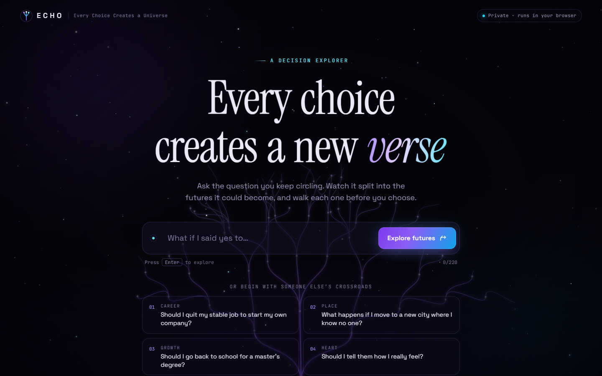
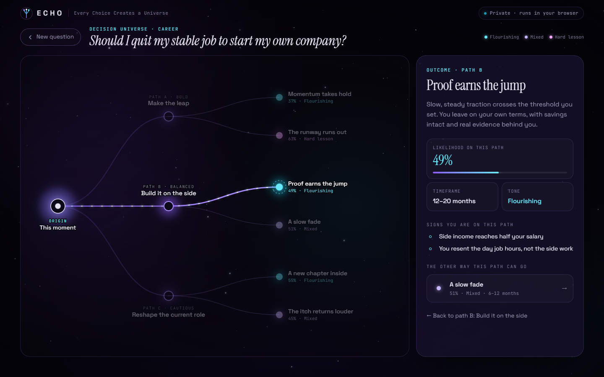
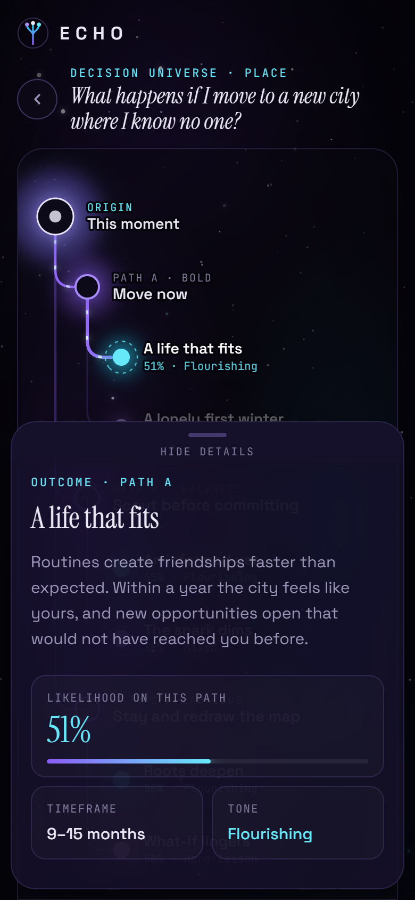

# ECHO · Decision Universe

**Every choice creates a new verse.**

ECHO is an interactive decision explorer. Type a question you keep circling, such as *"Should I quit my job to start a company?"*, and watch it unfold into an animated universe of possible futures: one origin, three paths and six outcomes, each with its own story, likelihood and timeframe.

Everything runs in your browser. There is no backend, no account and no API key, and your question never leaves your device.



## Features

- **Cinematic landing page.** A twinkling SVG starfield with mouse parallax, a procedurally grown branching backdrop and a headline that rises in word by word.
- **Question input with examples.** An auto-growing input with validation and a character counter, plus four example questions that type themselves in.
- **Animated decision tree.** An SVG tree that grows with GSAP: the root appears, three paths draw outward, then each splits into two outcomes.
- **Clickable nodes.** Selecting a node highlights its path back to the root with a flowing glow, dims unrelated nodes and opens a detail panel.
- **Detail panel:**
  - **Paths:** a description, first steps and both possible outcomes.
  - **Outcomes:** a description, the likelihood within that path, a timeframe, a tone (Flourishing, Mixed or Hard lesson) and signs that you're on that path.
- **Local scenario engine.** Questions are sorted into themes (career, moving, learning, relationships, or a general set). The general set rephrases your own words into the scenario text, and the same question always produces the same tree.
- **Responsive layout:**
  - Wide screens show a left-to-right tree with a side panel.
  - Narrow screens switch to an indented, scrollable tree with a collapsible bottom sheet.
  - The layout engine checks label sizes so nodes and text never overlap.
- **Accessible:**
  - Nodes can be selected with Tab and Enter, and Escape steps back up the tree.
  - Elements carry ARIA labels and focus is managed between screens.
  - Text meets WCAG contrast guidelines, and animation is reduced when the system asks for it.

<p>
  
  &nbsp;
  
</p>

## Tech stack

| Area      | Choice                                                          |
| --------- | --------------------------------------------------------------- |
| UI        | [React 18](https://react.dev/)                                  |
| Build     | [Vite 5](https://vitejs.dev/)                                   |
| Animation | [GSAP 3](https://gsap.com/)                                     |
| Graphics  | Inline SVG (starfield, branching backdrop, decision tree)       |
| Styling   | Plain CSS with custom properties, one stylesheet per component  |
| Data      | Local, hand-written scenarios; no network requests or API keys  |

## Getting started

**Requirements:** [Node.js](https://nodejs.org/) 18 or newer, and npm.

```bash
git clone https://github.com/iamtanmaybaranwal/Echo-Decision-Universe.git
cd Echo-Decision-Universe
npm install
npm run dev
```

Then open the URL Vite prints (by default http://localhost:5173).

### Scripts

| Command           | What it does                                      |
| ----------------- | ------------------------------------------------- |
| `npm run dev`     | Start the development server with hot reload      |
| `npm run build`   | Create an optimized production build in `dist/`   |
| `npm run preview` | Serve the production build locally                |

The production build is a static site, so `dist/` can be deployed to any static host (GitHub Pages, Netlify, Vercel, Cloudflare Pages and so on).

## Project structure

```
src/
├── App.jsx                  # Screen flow: landing → transition → explorer
├── components/
│   ├── Starfield/           # SVG starfield with twinkle + parallax
│   ├── BranchingUniverse/   # Procedural background tree (landing backdrop)
│   ├── Header/ LogoMark/    # Brand
│   ├── LandingPage/         # Hero, question form, examples + intro/exit animation
│   ├── Hero/ QuestionForm/ QuestionInput/ ExploreButton/ ExampleQuestions/
│   ├── UniverseExplorer/    # Full-screen explorer; owns the selected path/outcome
│   ├── DecisionTree/        # SVG tree, highlight states, GSAP grow-in
│   ├── TreeNode/            # A single clickable, keyboard-accessible SVG node
│   └── DetailPanel/         # Side panel / mobile bottom sheet
├── data/
│   ├── exampleQuestions.js
│   └── scenarioLibrary.js   # Themes, paths and outcomes
├── hooks/                   # useTypewriter, useElementSize
├── lib/
│   ├── scenarioEngine.js    # Theme detection + scenario building
│   ├── treeLayout.js        # Horizontal / list layouts, label wrapping
│   ├── random.js            # Seeded random numbers for repeatable visuals
│   └── motion.js            # Reduced-motion check
└── styles/global.css        # Design tokens and base styles
```

## How the futures are generated

1. **Detect a theme.** The question is matched against keyword sets for career, moving, learning and relationships. Questions with no match, or an equal match for two themes, use a general set.
2. **Rephrase the question.** A leading "Should I…" or "What if I…" is removed and first-person words are switched to second person. For example, *"Should I sell my car?"* becomes *"sell your car"*, which the general scenarios use in their text.
3. **Set the odds.** Each path has a bold, a balanced or a cautious approach and two outcomes whose likelihoods add up to 100%. The odds shift slightly with a seed taken from the question, so different questions feel distinct while the same question always gives the same tree.

The scenarios are illustrative prompts for reflection, not predictions.

## Customizing

- **Add or edit scenarios** in `src/data/scenarioLibrary.js`. Each theme has `keywords` and three `branches`, and each branch has two `outcomes`.
- **Change the palette or fonts** through the CSS custom properties at the top of `src/styles/global.css`.
- **Change the example questions** in `src/data/exampleQuestions.js`.
